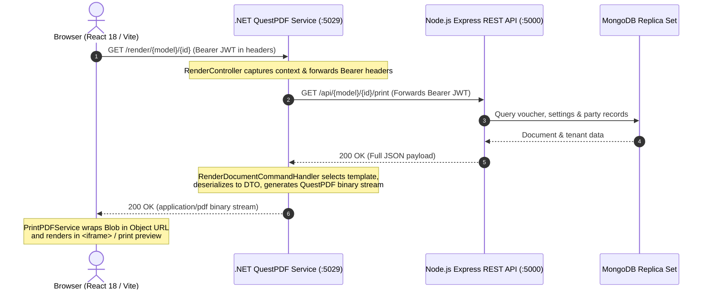

# Next Web Business — Technical Case Study & Engineering Record

**Slug:** `next-web-business`  
**Previous Name:** Billdesk  
**Project Archetype:** Business ERP (Invoicing, Inventory & Accounting)  
**Timeline:** Started November 2025 · In Production & Actively Maintained  
**Core Stack:** React, Vite, Node.js, Express, MongoDB, Mongoose, ASP.NET Core, QuestPDF, MediatR  
**Production Status:** 1 Production Customer Account · 50+ Active Sub-Users · Fully Deployed  

---

## 1. Project Context & Business Constraints

Next Web Business is a full-featured enterprise resource planning (ERP) platform designed for small-to-medium business workflows. It combines inventory management, multi-tier GST invoicing, recurring billing, accounts receivable/payable tracking, and manual GST portal reconciliation into an integrated application.

### Operating Environment & Constraints
* **Multi-User Concurrent Billing:** Supports multi-branch retail and warehouse operations where multiple staff members execute simultaneous billing against shared stock lots.
* **Strict Financial Compliance:** Real-world accounting demands zero tolerance for floating-point calculation drift, strict separation of Intra-State vs Inter-State GST taxes, and defensible audit trails.
* **Asynchronous Service Boundaries:** Multi-page PDF invoices with complex vector tables, dynamic headers, and embedded fonts cannot run inside a single-threaded Node.js event loop without degrading API throughput.

---

## 2. Personal Responsibilities & Engineering Ownership

* **Full-Stack ERP Core:** Co-architected and implemented core modules including Voucher management, Product/Inventory catalogs, Contact directories, and Financial Registers.
* **Dedicated .NET Document Platform:** Independently designed, built, and deployed an external ASP.NET Core microservice utilizing QuestPDF to handle high-fidelity PDF document assembly.
* **Cross-Stack Service Integration:** Implemented reverse JSON hydration contracts, header-forwarding authentication, and direct binary streaming between the Node.js Express backend and the .NET microservice.
* **Concurrency & ACID Transactions:** Re-architected inventory stock depletion (`InventoryHelper._processDatabaseOperations`) using MongoDB replica-set sessions to eliminate FIFO race conditions.
* **Production Operations:** Managed ongoing deployment, database indexing, and bug resolution for 50+ active sub-users on a live production deployment.

---

## 3. System Architecture & Component Interaction

Next Web Business uses a clean separation of concerns between client UI, operational API routing, persistent database storage, and document rendering compute:



### Architectural Tiers
1. **Frontend Layer:** React 18, Vite, Tailwind CSS 4, HeroUI, TanStack Query, Redux Toolkit, Axios.
2. **Application Backend:** Node.js, Express REST API, Mongoose ORM, Zod validation.
3. **Document Rendering Engine:** ASP.NET Core, C#, QuestPDF, MediatR CQRS pipeline.
4. **Data Persistence:** MongoDB Replica Set with tenant-keyed collections and multi-document transactions.

---

## 4. Key Engineering Challenges & Implementation Solutions

### Challenge A: Offloading PDF Compilation from the Node.js Event Loop
* **Problem:** Generating complex, multi-page invoice PDFs with dynamic pagination, corporate branding, and nested tax tables inside Node.js (`puppeteer` or `pdfkit`) caused significant CPU spikes and blocked the single-threaded event loop, leading to latency spikes across all concurrent REST endpoints.
* **Solution:** Developed a dedicated microservice in ASP.NET Core using QuestPDF. The service operates independently, receiving document rendering requests, authenticating via forwarded JWT headers, fetching raw JSON data from Express, compiling vector PDFs via QuestPDF's high-performance native engine, and streaming binary bytes directly back to the client.

#### Controller Contract (`RenderController.cs`)
```csharp
[HttpGet("{model}/{id}")]
public async Task<IActionResult> RenderDocument([FromRoute] string model, [FromRoute] string id)
{
    var context = new HttpRequestContext
    {
        RouteDocumentType = model,
        RouteDocumentId = id,
        QueryString = Request.QueryString.Value ?? string.Empty
    };

    // Forward incoming auth and tenancy headers to upstream Express API
    foreach (var header in Request.Headers)
    {
        context.Headers[header.Key] = header.Value.ToString();
    }

    var command = new RenderDocumentCommand { RequestContext = context };

    try
    {
        var pdfBytes = await _mediator.Send(command);
        return File(pdfBytes, "application/pdf", $"{model}-{id}.pdf");
    }
    catch (System.Exception ex)
    {
        return BadRequest(new { Error = ex.Message });
    }
}
```

#### Application Handler (`RenderDocumentCommandHandler.cs`)
```csharp
public async Task<byte[]> Handle(RenderDocumentCommand request, CancellationToken cancellationToken)
{
    // 1. Forward request to upstream Express REST API to fetch JSON data
    string jsonPayload = await _erpService.GetDocumentDataAsync(request.RequestContext, cancellationToken);

    // 2. Resolve template dynamically from payload settings
    string templateName = "Standard";
    try
    {
        using var doc = System.Text.Json.JsonDocument.Parse(jsonPayload);
        if (doc.RootElement.TryGetProperty("data", out var dataElement) &&
            dataElement.TryGetProperty("settings", out var settingsElement) &&
            settingsElement.TryGetProperty("pdf_template", out var pdfTemplateElement))
        {
            var val = pdfTemplateElement.GetString();
            if (!string.IsNullOrWhiteSpace(val)) templateName = val;
        }
    }
    catch { /* fallback to default */ }

    // 3. Metadata validation & disabled template guard
    var metadata = _registry.GetMetadata(request.RequestContext.RouteDocumentType, templateName);
    if (!metadata.Configuration.IsEnabled)
    {
        throw new System.Exception("Template is disabled.");
    }

    // 4. Resolve QuestPDF renderer & execute binary stream generation
    var renderer = _rendererFactory.GetRenderer(request.RequestContext.RouteDocumentType, templateName);
    return await renderer.RenderAsync(jsonPayload, metadata.Configuration, cancellationToken);
}
```

---

### Challenge B: Eliminating FIFO Stock Lot Concurrency Race Conditions
* **Problem:** Multiple cashiers billing simultaneously at the same branch caused race conditions when depleting inventory batches under a First-In, First-Out (FIFO) lot depletion model, resulting in negative inventory buckets and ledger discrepancies.
* **Solution:** Re-architected `InventoryHelper.adjustStock` into an atomic pipeline (`_processDatabaseOperations`) executing inside a MongoDB replica-set transaction session (`mongoose.startSession()`). Used `$expr` conditional filters to prevent inventory reversal over-consumption and hard-deleted drained buckets.

#### Atomic Transaction Pipeline (`InventoryHelper.js`)
```javascript
static async _processDatabaseOperations(databaseOperations, { session: externalSession }) {
    const session = externalSession || await mongoose.startSession();
    const createdOwnSession = !externalSession;
    if (createdOwnSession) session.startTransaction();

    try {
        // 1. Conditional query check ($expr) to ensure reversal doesn't exceed original qty
        const res = await Voucher.model.findOne(filter).session(session);
        await res.save({ session });

        // 2. Multi-document atomic batch operations
        if (databaseOperations.Inventory.create.length > 0)
            await Inventory.insertMany(databaseOperations.Inventory.create, { session });

        for (let op of databaseOperations.Product.update)
            await Product.updateOne(op.filter, op.update, { session });

        for (let op of databaseOperations.Inventory.update)
            await Inventory.updateOne(op.filter, op.update, { session });

        // Drained inventory buckets are hard-deleted
        for (let op of databaseOperations.Inventory.delete)
            await Inventory.deleteOne({ _id: op._id }, { session });

        // Immutable transaction ledger entries
        if (databaseOperations.InventoryTransaction.create.length > 0)
            await InventoryTransaction.insertMany(databaseOperations.InventoryTransaction.create, { session });

        if (createdOwnSession) await session.commitTransaction();
    } catch (error) {
        if (createdOwnSession) await session.abortTransaction();
        throw error;
    } finally {
        if (createdOwnSession) await session.endSession();
    }
}
```

---

### Challenge C: Dual-Engine Calculation Parity & Multi-Tier GST Math
* **Problem:** Complex commercial invoices feature line-level percentage or absolute discounts, dynamic tax rates, place-of-supply tax splits, and floating-point math quirks. Client-side lag causes frustration, while trusting client math creates security and compliance vulnerabilities.
* **Solution:** Implemented synchronized calculation engines between React and Express:
  - **Client-Side:** State-affecting fields (`placeOfSupply`, `sellerStateCode`) trigger instant recalculations; numeric keystrokes (`price`, `qty`, `discount`) debounce by 120ms. Mutated rows are identified via `lodash.isEqual` deep-diffing.
  - **Server-Side:** Express completely recalculates line totals, taxable amounts, and tax splits, enforcing authoritative rounding via `NumberHelper.round` and generating currency word strings (`NumberHelper.numberToWords`) before writing to the database.

#### Dynamic Tax Resolution (`TaxationHelper.js`)
```javascript
static getTaxType(sellerStateCode, placeOfSupplyStateCode) {
    if (!sellerStateCode || !placeOfSupplyStateCode) return "CGST_SGST";
    return sellerStateCode === placeOfSupplyStateCode ? "CGST_SGST" : "IGST";
}
```
* **Intra-State (`CGST_SGST`):** Automatically split 50% CGST and 50% SGST.
* **Inter-State (`IGST`):** 100% allocated to IGST.
* **HSN/SAC Summaries:** Aggregated per code into a structured `summary` array on the voucher.

---

### Challenge D: Three-Tier Multi-Tenancy Scoping
* **Architecture:** Shared MongoDB database with tenant-keyed collections.
* **Hierarchy:**
  - `user`: Root account tenant ID (`req.user.admin || req.user._id`).
  - `business`: Specific business enterprise workspace (`req.user.business`).
  - `location`: Specific warehouse, retail branch, or storage facility (`req.user.location`).
* **Enforcement:** Enforced via `customFilter` middleware hooks on read operations, and automated injection of `{ user, business, location }` from JWT claims on write operations.

---

## 5. Factual GST Reconciliation Flow

In alignment with verified project records:
* Next Web Business supports **manual reconciliation**. Automated JSON ingestion or direct government portal scraping is **not** implemented.
* The system organizes transactions into discrete accounting registers: `Sale`, `Purchase`, `SaleReturn`, `PurchaseReturn`, `CashSale`, and `CashPurchase`.
* Accountants use status filters (`Draft`, `Approved`, `Pending`, `Sent`, `Unpaid`, `Paid`), date range selectors, and table search to manually cross-reference internal records against external GSTR-2B and GSTR-1 filings.

---

## 6. Production Metrics & Governance Boundaries

* **Production Adoption:** 1 verified production customer account with 50+ active sub-users.
* **Confidentiality Standard:** All client business names, financial amounts, customer identities, and live API endpoints are strictly redacted.
* **Demo/Repo Boundaries:** Source code is private. Public demo URLs are not exposed to protect customer operational stability. Visuals are limited to sanitized screenshots and architecture diagrams.

