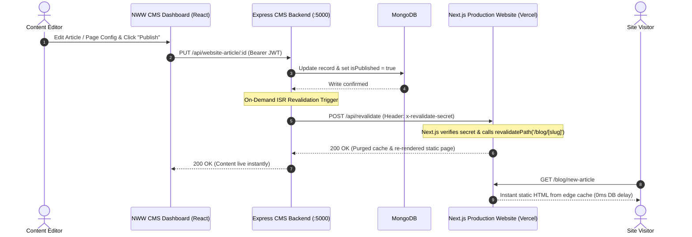

# Next Web Website — Technical Case Study & Engineering Record

**Slug:** `next-web-website`  
**Project Archetype:** Headless CMS, Dynamic Publishing Engine & On-Demand Revalidation Platform  
**Timeline:** Started 2024–2025 · Deployed in Production & Actively Maintained  
**Core Stack:** Node.js, Express, MongoDB, Mongoose, Next.js (App Router), ISR (Incremental Static Regeneration), Webhooks, HMAC Secret Authentication  
**Production Status:** Production Platform · Powers Multi-Tenant Client Websites & Headless Frontends  

---

## 1. Project Context & Purpose

**Next Web Website** is the headless content management system (CMS) and dynamic website delivery engine built within the Next Web Works platform ecosystem. It was engineered to solve a common dilemma in modern web development: businesses want the ease of an intuitive CMS to edit articles, services, case studies, and page copy, while engineering teams require the blazing-fast load times, SEO benefits, and security of static Next.js App Router websites.

Next Web Website bridges this gap by acting as a high-performance headless backend that pairs with Next.js frontends via **on-demand Incremental Static Regeneration (ISR)** and cryptographically authenticated revalidation webhooks.

---

## 2. Personal Responsibilities & Engineering Ownership

* **Headless Backend Architecture:** Designed and implemented the complete `website` feature domain in `edu-manage-be/src/features/website/`, encompassing 14 specialized content sub-modules.
* **On-Demand ISR Revalidation Protocol:** Designed the webhook invalidation architecture connecting the Express backend to remote Next.js App Router applications, eliminating full site rebuilds when content updates.
* **Multi-Tenant Site Isolation:** Architected the schema model (`Website.js`) isolating client sites by unique site identifiers, tenant owners, domain maps, and dedicated webhook secrets.
* **Lead Capture & Contact Engine:** Implemented the public `/api/website-contact-us/:id/submit` endpoint featuring payload validation, spam traps, rate limiting, and automated webhook notifications.
* **High-Throughput Public API:** Engineered optimized unauthenticated public endpoints in Express with lean projections (`.lean().select(...)`) delivering sub-50ms TTFB for static generation and client hydration.

---

## 3. System Architecture & Revalidation Pipeline



### Architectural Tiers
1. **Administrative CMS Studio:** Modular React/Vite dashboard interface allowing non-technical teams to manage articles, project case studies, services, team members, and form submissions.
2. **Headless Express REST API:** Centralized content API providing authenticated authoring endpoints and ultra-lean public consumption routes.
3. **Edge Static Next.js Frontends:** Decoupled Next.js App Router client sites consuming headless JSON schemas at build time, revalidating on-demand via webhooks.
4. **Data Isolation Layer:** MongoDB collections scoped by `website` and `user` with composite indexes on `{ website: 1, slug: 1, isDeleted: 1 }`.

---

## 4. Comprehensive Headless Feature Modules

In [`edu-manage-be/src/features/website`](file:///c:/code/next-web-works/edu-manage-be/src/features/website), Next Web Website is architected into 14 purpose-built domain modules:

| Sub-Module | Domain Responsibility | Data Capabilities & Contracts |
| :--- | :--- | :--- |
| `website` | Site Instance Core | Business metadata, brand colors, typography tokens, logo URLs, domain routing, revalidation webhook URLs, and secrets. |
| `article` | Technical Blog Engine | Markdown & rich-text body, featured hero image, categories, tags, reading time estimation, author attribution, and SEO OpenGraph tags. |
| `case-study` | Engineering Portfolios | Project briefs, client constraints, tech stack badges, outcome metrics, and image gallery references. |
| `page-config` | Dynamic Page Layouts | Declarative key-value JSON schemas powering dynamic page sections, hero banners, and feature grids. |
| `contact-us` | Lead Capture & Inquiries | Public submission handler with honeypot validation, automated email dispatches, and third-party webhook routing. |
| `service` | Solutions & Offerings | Structured service offerings with icon keys, feature checklists, and pricing tier references. |
| `plan` | Commercial Pricing Plans | Subscription tiers, monthly/annual billing frequencies, feature comparison matrices, and CTA target links. |
| `job` | Careers & Openings | Department categories, employment types (`Full-time`, `Contract`), compensation ranges, and application submission targets. |
| `event` | Workshops & Meetups | Event schedules, venue maps/virtual links, speaker profiles, and attendee registration limits. |
| `gallery` | Media Asset Libraries | Categorized image collections with responsive focal points, captions, and CDN delivery URLs. |
| `industry` | Target Market Sectors | Sector-specific landing content, pain point overviews, and linked customer testimonials. |
| `legal` | Compliance & Policies | Versioned policies (`privacy-policy`, `terms-and-conditions`, `refund-policy`) with revision timestamps. |

---

## 5. Key Engineering Challenges & Solutions

### Challenge A: Bridging Headless Updates with Zero-Downtime Next.js Caching
* **The Problem:** Traditional static site generators require 5-minute CI/CD pipeline builds whenever a typo or article is published. Pure server-side rendering (SSR), on the other hand, causes slow Time-to-First-Byte (TTFB) and database load spikes.
* **The Solution:** Implemented authenticated **On-Demand Incremental Static Regeneration (ISR)**.
  1. The `Website` model stores `revalidation_webhook` and `revalidation_secret`.
  2. Upon saving a mutation in `article.route.js` or `page-config.route.js`, the Express backend dispatches an authenticated HTTP POST:
     ```javascript
     if (website.revalidation_webhook && website.revalidation_secret) {
       await axios.post(website.revalidation_webhook, {
         path: `/blog/${article.slug}`,
         model: "article"
       }, {
         headers: { "x-revalidate-secret": website.revalidation_secret }
       });
     }
     ```
  3. The Next.js edge route verifies the secret via constant-time comparison and invokes `revalidatePath()`, purging edge cache tags in milliseconds while maintaining static speed.

---

### Challenge B: High-Throughput Public API Performance
* **The Problem:** Frontend static build processes and on-demand ISR fetch dozens of pages and records in parallel. Unoptimized Mongoose document hydration creates heavy object instantiation overhead.
* **The Solution:** Public content endpoints utilize `.lean().select(...)` projections, bypassing Mongoose virtuals and change-tracking overhead to return raw JSON streams directly. Composite indexes on `{ website: 1, slug: 1, isDeleted: 1 }` guarantee single-digit millisecond query execution in MongoDB.

---

## 6. Production Adoption & Governance Boundaries

* **Production Usage:** Deployed and actively powers live client websites within the Next Web Works network as well as this portfolio’s dynamic blog and contact systems.
* **Security & Secret Hygiene:** `revalidation_secret` and administrative database keys are strictly isolated in environment variables (`CMS_SITE_KEY`, `REVALIDATE_SECRET`); never exposed to client-side bundles or public repositories.

