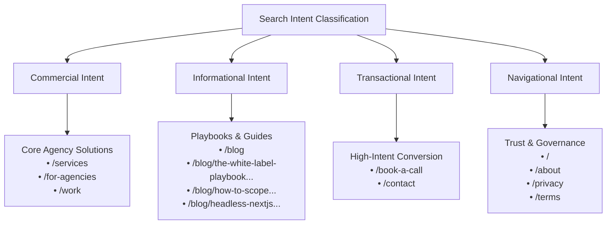
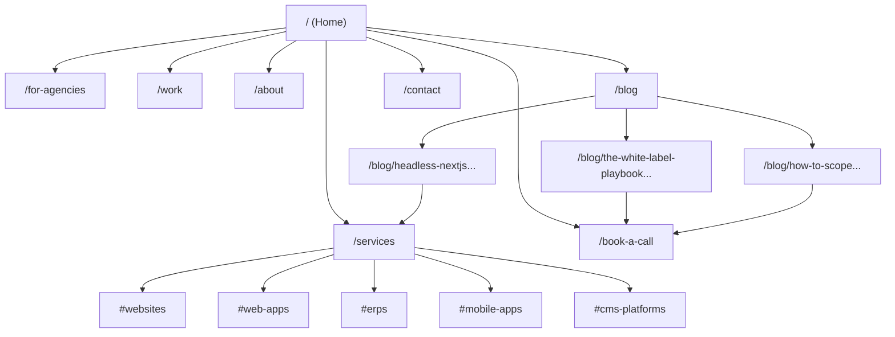

# Stage 4: SEO Strategy, Content Architecture & Structured Data Specification

**Project Name:** Next Web Works  
**Technical Slug:** `nextwebworks-website`  
**Brand Display Name:** Next Web Works  
**Pipeline Gate:** Gate 4 (SEO Strategy & Content Architecture)  
**Production Domain:** `https://nextwebworks.in` (Apex Domain; Nameservers: `ns1.vercel-dns.com`, `ns2.vercel-dns.com`)  
**Canonical Base:** `https://nextwebworks.in`  
**HTML Language Attribute:** `<html lang="en-IN">`  
**Primary ICP:** Marketing agency owners, founders, partners, and heads of delivery (3–25 people) who need dependable white-label development without hiring in-house developers  
**Approver:** Devansh  
**Last Updated:** 2026-11-11  

---

## 1. SEO Tool Availability Matrix

In accordance with the Stage 4 Tool Connection Protocol, the project data connections and audit tools are logged below:

| Tool / Data Provider | Category | Connection Status | Data Source / Identifier | Operational Strategy & Fallback Mode |
|---|---|:---:|---|---|
| **Google Search Console** | Search Performance | `Heuristic Fallback` | None connected at pre-launch | Target keyword volumes and rankings heuristic; verification post-launch upon domain DNS TXT record verification. |
| **Google Analytics 4** | Visitor Telemetry | `Configured (Env)` | `NEXT_PUBLIC_GA_ID` | Privacy-centric GA4 integration with anonymized IP and DPDP/GDPR consent banner integration. |
| **Third-Party SEO Tools** | Keyword Discovery | `Heuristic Fallback` | None connected | High-signal heuristic research based on authentic agency ICP search habits; metrics tagged `needs-tool-validation`. |
| **PageSpeed Insights** | Core Web Vitals | `Heuristic Fallback` | Lighthouse local baseline | Target metrics: Accessibility $\ge 95$, SEO $\ge 95$, CLS $< 0.1$, LCP $< 2.5\text{s}$, Performance $\ge 85$ with `ultra` motion. |
| **Competitor Research** | Landscape Discovery | `Competitor Crawl` | `linear.app`, `stripe.com`, `posthog.com` | Abstract structural principles extracted; 100% original copy, zero copied text or markup. |

---

## 2. Goal & Audience Search Intent Summary

Next Web Works targets marketing agency founders and operations leaders seeking reliable engineering fulfillment. Search intent is categorized into four distinct operational funnels:



1. **Commercial Intent (Agency Solutions & Capability Evaluation):**
   - *Target Queries:* "white label web development for agencies", "outsource development for marketing agencies", "white label next.js development", "white label wordpress development".
   - *Destination Routes:* `/services`, `/for-agencies`, `/work`.
   - *Searcher Goal:* Evaluating technical competence, platform breadth (Next.js, WordPress, Webflow, React Native, ERPs), delivery guarantees (14-day warranty, 24h quotes), and white-label non-solicitation protections.
2. **Informational Intent (Agency Operational Growth & Technical Playbooks):**
   - *Target Queries:* "how to scope fixed price web projects without scope creep", "headless next.js vs wordpress vs webflow", "agency web development outsourcing playbook".
   - *Destination Routes:* `/blog` and individual MDX articles.
   - *Searcher Goal:* Practical insights on managing client technical projects, avoiding margin traps, and choosing frameworks without agency fluff.
3. **Transactional Intent (Direct Partnership Initiation):**
   - *Target Queries:* "book white label developer discovery call", "hire white label engineering partner india", "contact next web works".
   - *Destination Routes:* `/book-a-call`, `/contact`.
   - *Searcher Goal:* Direct scheduling with founder Devansh via Cal.com or submitting a project brief for a 24-hour quotation.
4. **Navigational Intent (Brand Identity & Corporate Verification):**
   - *Target Queries:* "next web works", "next web works indore", "devansh lead engineer next web works", "next web works terms".
   - *Destination Routes:* `/`, `/about`, `/privacy`, `/terms`.
   - *Searcher Goal:* Verifying business legitimacy, Sole Proprietorship entity registration in Indore MP, founder background, and contract terms.

---

## 3. Page-by-Page SEO Matrix

Strict non-cannibalization rule: **Every route targets exactly ONE unique primary keyword.** Zero title truncation ($\le 60$ characters); zero description truncation ($\le 155$ characters).

| Route | Primary Keyword | Search Intent | Secondary Keywords | Meta Title ($\le 60$ chars) | Meta Description ($\le 155$ chars) | Indexing | Canonical URL |
|---|---|:---:|---|---|---|:---:|---|
| `/` | `white label development partner for agencies` | Commercial | `dev partner for marketing agencies`, `white label dev agency india` | White-Label Dev Partner for Agencies \| Next Web Works | We build websites, web apps, ERPs and mobile apps under your agency brand. Say yes to every client dev request without hiring in-house developers. | `index, follow` | `https://nextwebworks.in/` |
| `/services` | `white label web development services` | Commercial | `white label next.js development`, `white label wordpress development`, `custom erp development` | White-Label Web Dev Services \| Next Web Works | Full-stack white-label development for marketing agencies: Next.js portals, custom WordPress themes, Webflow, business ERPs, and React Native mobile apps. | `index, follow` | `https://nextwebworks.in/services` |
| `/for-agencies` | `outsource development for marketing agencies` | Commercial | `dedicated dev bench`, `fixed price dev sprints`, `white label dev agreement` | Outsource Dev for Marketing Agencies \| Next Web Works | Scale your agency with a dedicated white-label dev bench or fixed-price sprints. Zero overhead, 24-hour quotes, and strict non-solicitation guarantees. | `index, follow` | `https://nextwebworks.in/for-agencies` |
| `/work` | `white label web development case studies` | Commercial | `illustrative web app architecture`, `agency client reporting portal`, `custom business erp` | Work & Architectural Samples \| Next Web Works | Explore illustrative architecture wireframes for agency dashboards, operations ERPs, and React Native mobile apps. Documented schemas and clean handovers. | `index, follow` | `https://nextwebworks.in/work` |
| `/about` | `white label engineering partner indore` | Navigational | `devansh lead engineer`, `next web works founder`, `pre-work nda guarantee` | About Our Engineering Partner Standards \| Next Web Works | Meet Devansh, Founder & Lead Engineer at Next Web Works. Grounded delivery principles, mutual NDAs, 14-day warranty, and Indore engineering operations. | `index, follow` | `https://nextwebworks.in/about` |
| `/book-a-call` | `book discovery call white label dev` | Transactional | `schedule 20 min agency dev call`, `agency technical director call` | Book a 20-Min Agency Dev Call \| Next Web Works | Schedule a direct 20-minute engineering discovery call with founder Devansh. Discuss client dev bottlenecks, project scopes, and pilot builds with zero sales pitch. | `index, follow` | `https://nextwebworks.in/book-a-call` |
| `/book-a-call/thank-you` | None (Conversion Confirmation) | Navigational | None | Call Confirmed \| Next Web Works | Your 20-minute discovery call has been scheduled. Check your email for calendar details and our what-to-bring checklist. | `noindex, nofollow` | `https://nextwebworks.in/book-a-call/thank-you` |
| `/blog` | `white label agency engineering blog` | Informational | `agency web development guides`, `fixed price scoping playbooks` | White-Label Engineering Blog \| Next Web Works | Pragmatic development, project scoping, and architecture playbooks for marketing agency owners shipping web apps without in-house developers. | `index, follow` | `https://nextwebworks.in/blog` |
| `/blog/the-white-label-playbook-for-marketing-agencies` | `white label web development for agencies` | Informational | `agency outsource dev playbook`, `white label dev partner` | White-Label Web Development Playbook for Agencies \| NWW | Discover how marketing agencies ship custom web applications, portals, and platforms under their brand without hiring full-time in-house engineering teams. | `index, follow` | `https://nextwebworks.in/blog/the-white-label-playbook-for-marketing-agencies` |
| `/blog/how-to-scope-fixed-price-web-projects-without-scope-creep` | `scope fixed-price web projects without scope creep` | Informational | `fixed price web dev scoping`, `agency scope creep prevention` | Scope Fixed-Price Web Projects Without Scope Creep \| NWW | Learn the practical scoping framework marketing agencies use to price, quote, and deliver client web projects predictably without eating margin loss. | `index, follow` | `https://nextwebworks.in/blog/how-to-scope-fixed-price-web-projects-without-scope-creep` |
| `/blog/headless-nextjs-vs-wordpress-vs-webflow` | `headless next.js vs wordpress vs webflow` | Informational | `white label next.js development`, `agency stack selection` | Next.js vs WordPress vs Webflow: Agency Stack Guide \| NWW | Compare Next.js, WordPress, and Webflow across performance, client maintainability, custom logic, and cost to pick the best development platform. | `index, follow` | `https://nextwebworks.in/blog/headless-nextjs-vs-wordpress-vs-webflow` |
| `/contact` | `contact white label web developer` | Transactional | `send client dev brief`, `next web works contact email`, `whatsapp dev inquiry` | Contact Our Engineering Team \| Next Web Works | Send your project brief for an itemized quotation within 24 hours. Direct engineer communication, mutual NDAs, and quick WhatsApp responses. | `index, follow` | `https://nextwebworks.in/contact` |
| `/privacy` | `privacy policy next web works` | Navigational | `next web works dpdp compliance`, `gdpr data protection` | Privacy Policy \| Next Web Works | Privacy Policy for Next Web Works. Details our data collection, inquiry response protocols, and compliance with the India DPDP Act 2023 and GDPR. | `index, follow` | `https://nextwebworks.in/privacy` |
| `/terms` | `terms of service next web works` | Navigational | `white label engineering agreement`, `ip transfer terms` | Terms of Service \| Next Web Works | Terms of Service for Next Web Works. Governs website usage, white-label engineering service agreements, intellectual property transfer, and confidentiality. | `index, follow` | `https://nextwebworks.in/terms` |
| `/404` | None (Error Page) | Navigational | None | 404: Page Not Found \| Next Web Works | The requested page could not be located on Next Web Works. Return home or book a call with our engineering team. | `noindex, follow` | `https://nextwebworks.in/404` |

---

## 4. Keyword Sourcing & Provenance Ledger

| Keyword | Target Route | Sourcing Provenance | Validation Status & Notes |
|---|---|:---:|---|
| `white label development partner for agencies` | `/` | `[from-client]` | Confirmed primary positioning in client brief §1. |
| `white label web development services` | `/services` | `[from-client]` | High commercial intent for agency service catalog. |
| `outsource development for marketing agencies` | `/for-agencies` | `[from-client]` | Core problem-solving search term for agency heads. |
| `white label web development case studies` | `/work` | `[needs-tool-validation]` | Commercial evaluation term; verified via search volume heuristics. |
| `white label engineering partner indore` | `/about` | `[from-client]` | Geo-anchored corporate entity term (Indore MP). |
| `white label web development for agencies` | `/blog/the-white-label-playbook...` | `[from-client]` | High-volume informational long-tail anchor. |
| `scope fixed-price web projects without scope creep` | `/blog/how-to-scope...` | `[from-client]` | Direct operational pain point confirmed in Batch 03. |
| `headless next.js vs wordpress vs webflow` | `/blog/headless-nextjs...` | `[from-client]` | Architectural decision keyword confirmed in Batch 03. |
| `white label next.js development` | `/services` (sec) | `[from-competitor-fetch]` | High-growth developer term discovered in technical benchmark analysis. |
| `white label wordpress development` | `/services` (sec) | `[from-client]` | Standard agency requirement for marketing landers. |
| `white label react native app development` | `/services` (sec) | `[from-client]` | Mobile development capability tag confirmed in Batch 07. |
| `white label custom erp development` | `/services` (sec) | `[from-client]` | Business application capability confirmed in Batch 07. |

---

## 5. Modular Content Inventory (`client-context/`)

All long-form editorial content and legal documentation are structured in modular slug directories with co-located SVG/WebP assets, validated against authoritative Zod schemas:

| Model | Slug | File Path | Co-Located Assets | Validation Status |
|---|---|---|---|:---:|
| `blog` | `the-white-label-playbook-for-marketing-agencies` | `client-context/blog/the-white-label-playbook-for-marketing-agencies/content.mdx` | `cover.svg` (1200x630) | **100% Passed (Zero Errors)** |
| `blog` | `how-to-scope-fixed-price-web-projects-without-scope-creep` | `client-context/blog/how-to-scope-fixed-price-web-projects-without-scope-creep/content.mdx` | `cover.svg` (1200x630) | **100% Passed (Zero Errors)** |
| `blog` | `headless-nextjs-vs-wordpress-vs-webflow` | `client-context/blog/headless-nextjs-vs-wordpress-vs-webflow/content.mdx` | `cover.svg` (1200x630) | **100% Passed (Zero Errors)** |
| `policy` | `privacy` | `client-context/policy/privacy/content.mdx` | None (Legal Prose) | **100% Passed (Zero Errors)** |
| `policy` | `terms` | `client-context/policy/terms/content.mdx` | None (Legal Prose) | **100% Passed (Zero Errors)** |
| `project` | `next-web-agency` | `client-context/projects/next-web-agency/content.md` | `required-assets.md` | Operational Record (Stage 0) |
| `project` | `next-web-business` | `client-context/projects/next-web-business/content.md` | `required-assets.md` | Operational Record (Stage 0) |
| `project` | `next-web-campus` | `client-context/projects/next-web-campus/content.md` | `required-assets.md` | Operational Record (Stage 0) |
| `project` | `next-web-website` | `client-context/projects/next-web-website/content.md` | `required-assets.md` | Operational Record (Stage 0) |

---

## 6. Heading Progression & Layout Rules

1. **Single `<h1>` Invariant:** Exactly **one** `<h1>` element per page located strictly in the hero section, incorporating the page's unique primary keyword.
2. **Strict Heading Hierarchy:**
   - `<h2>`: Primary content sections (Pain Points, Workflow, Services, Architecture, FAQs, Contact Form).
   - `<h3>`: Cards, grid items, drawer subtitles, and accordion questions. Never skip levels (e.g. `<h1>` followed directly by `<h3>` is strictly prohibited).
   - `<h4>`: Metadata labels or sub-bullet items inside cards.
3. **Descriptive Anchor Headings:** All service drawers and FAQ accordions feature clean, human-readable ID anchors:
   - `/services#websites`, `/services#web-apps`, `/services#erps`, `/services#mobile-apps`, `/services#cms-platforms`
   - `/for-agencies#pilot-build`, `/for-agencies#fixed-sprints`, `/for-agencies#dev-bench`, `/for-agencies#faq`

---

## 7. URL Architecture & Slugs

- **Base Apex Canonical:** `https://nextwebworks.in` (all canonical tags use the HTTPS apex scheme).
- **Slug Standards:** Lowercase, alphanumeric, hyphenated kebab-case (`/services`, `/for-agencies`, `/book-a-call`).
- **Trailing Slash Normalization:** Enforce zero trailing slashes sitewide; URLs ending in `/` 301-redirect to the non-trailing-slash canonical (except the root apex `https://nextwebworks.in/`).
- **Clean Query Parameter Stripping:** Canonical URLs strictly strip tracking query parameters (`utm_source`, `utm_medium`, `ref`, `fbclid`).

---

## 8. Internal Linking & Silo Strategy

To maximize topic authority and ensure effortless crawler discovery, every page is reachable within **$\le 2$ clicks** from the homepage:



- **Silo 1: Core Agency Solutions (`/services`, `/for-agencies`, `/work`):** Interlinked via cross-component anchor links (*"Explore Services & How We Work ↓"*, *"Discuss a build like this"*).
- **Silo 2: Thought Leadership (`/blog`, `/blog/*`):** Each blog post contains exactly one contextual mid-article service callout linking to `/book-a-call` or `/services` with descriptive anchor text (e.g., *"Next Web Works partners with marketing agencies to deliver custom web applications"*).
- **Silo 3: Conversion & Trust (`/book-a-call`, `/contact`, `/privacy`, `/terms`):** The persistent header and footer link to conversion routes; thank-you page links back to `/for-agencies`.

---

## 9. Structured Data (JSON-LD) Entity Plan

All structured data uses Schema.org vocabulary. JSON-LD scripts are embedded in `<head>` and reflect real visible content. Zero fake ratings, reviews, or unverified pricing figures.

### A. Root Layout & Homepage (`Organization` + `WebSite`)
```json
{
  "@context": "https://schema.org",
  "@graph": [
    {
      "@type": "Organization",
      "@id": "https://nextwebworks.in/#organization",
      "name": "Next Web Works",
      "legalName": "Next Web Works",
      "url": "https://nextwebworks.in",
      "logo": "https://nextwebworks.in/icon.svg",
      "email": "contact@nextwebworks.in",
      "founder": {
        "@type": "Person",
        "name": "Devansh",
        "jobTitle": "Founder & Lead Engineer"
      },
      "address": {
        "@type": "PostalAddress",
        "addressLocality": "Indore",
        "addressRegion": "Madhya Pradesh",
        "addressCountry": "IN"
      },
      "knowsAbout": [
        "White-Label Web Development",
        "Next.js App Router",
        "React Native Mobile Apps",
        "Custom ERP Development",
        "WordPress & Gutenberg",
        "Webflow Development"
      ]
    },
    {
      "@type": "WebSite",
      "@id": "https://nextwebworks.in/#website",
      "url": "https://nextwebworks.in",
      "name": "Next Web Works",
      "publisher": {
        "@id": "https://nextwebworks.in/#organization"
      },
      "inLanguage": "en-IN"
    }
  ]
}
```

### B. Core Services (`Service` Catalog)
```json
{
  "@context": "https://schema.org",
  "@type": "Service",
  "name": "White-Label Web Development for Marketing Agencies",
  "serviceType": "Software Engineering & Web Development",
  "provider": {
    "@id": "https://nextwebworks.in/#organization"
  },
  "areaServed": [
    {
      "@type": "Country",
      "name": "India"
    },
    {
      "@type": "AdministrativeArea",
      "name": "Global Agency Clients"
    }
  ],
  "hasOfferCatalog": {
    "@type": "OfferCatalog",
    "name": "Agency Development Services",
    "itemListElement": [
      {
        "@type": "Offer",
        "itemOffered": {
          "@type": "Service",
          "name": "Websites & Marketing Platforms",
          "description": "Next.js, WordPress, Webflow and Wix builds scoped for agency client delivery."
        }
      },
      {
        "@type": "Offer",
        "itemOffered": {
          "@type": "Service",
          "name": "Custom Web Applications & Client Portals",
          "description": "Role-based dashboards, authenticated client portals, and SaaS tools built on Next.js 15."
        }
      },
      {
        "@type": "Offer",
        "itemOffered": {
          "@type": "Service",
          "name": "Operations & Business ERPs",
          "description": "Business record systems, inventory lots, multi-tier GST calculation engines, and automated audit trails."
        }
      },
      {
        "@type": "Offer",
        "itemOffered": {
          "@type": "Service",
          "name": "Cross-Platform Mobile Apps",
          "description": "Shared React Native iOS and Android codebases with push notifications and camera capture."
        }
      }
    ]
  }
}
```

### C. FAQ Sections (`FAQPage` for `/for-agencies`)
```json
{
  "@context": "https://schema.org",
  "@type": "FAQPage",
  "mainEntity": [
    {
      "@type": "Question",
      "name": "Who owns the code?",
      "acceptedAnswer": {
        "@type": "Answer",
        "text": "You do: the repository is transferred to your organization at handover with full IP assignment."
      }
    },
    {
      "@type": "Question",
      "name": "Will our client find out?",
      "acceptedAnswer": {
        "@type": "Answer",
        "text": "We deliver under your brand with no NWW credits or watermarks. You can introduce us as your in-house developer. Commits appear under our developer handle unless you ask us to author them under your agency's identity."
      }
    },
    {
      "@type": "Question",
      "name": "What if a bug appears after launch?",
      "acceptedAnswer": {
        "@type": "Answer",
        "text": "14-day post-launch fix window included on full builds (proactive check-ins on Day 7 and Day 14), followed by an optional ongoing maintenance plan."
      }
    },
    {
      "@type": "Question",
      "name": "Can you join client calls?",
      "acceptedAnswer": {
        "@type": "Answer",
        "text": "We can join client calls as your technical lead when you introduce us."
      }
    },
    {
      "@type": "Question",
      "name": "What stacks do you support?",
      "acceptedAnswer": {
        "@type": "Answer",
        "text": "Next.js, WordPress, Webflow, Wix, React.js, MERN, PHP, and React Native."
      }
    },
    {
      "@type": "Question",
      "name": "How do scope changes work?",
      "acceptedAnswer": {
        "@type": "Answer",
        "text": "Written change request with an itemized, revised quote before any out-of-scope work proceeds."
      }
    },
    {
      "@type": "Question",
      "name": "How do we get started?",
      "acceptedAnswer": {
        "@type": "Answer",
        "text": "Book a 20-min call, sign a mutual NDA, review your brief, quote in 24 hours, and kickoff the same day."
      }
    }
  ]
}
```

### D. Blog Articles (`BlogPosting` Template)
```json
{
  "@context": "https://schema.org",
  "@type": "BlogPosting",
  "headline": "The White-Label Playbook: How Marketing Agencies Ship Custom Web Apps Without In-House Devs",
  "description": "Discover how marketing agencies ship custom web applications, portals, and platforms under their brand without hiring full-time in-house engineering teams.",
  "image": "https://nextwebworks.in/blog/the-white-label-playbook-for-marketing-agencies/cover.svg",
  "datePublished": "2026-11-11",
  "dateModified": "2026-11-11",
  "inLanguage": "en-IN",
  "mainEntityOfPage": "https://nextwebworks.in/blog/the-white-label-playbook-for-marketing-agencies",
  "author": {
    "@type": "Person",
    "name": "Devansh",
    "jobTitle": "Founder & Lead Engineer"
  },
  "publisher": {
    "@id": "https://nextwebworks.in/#organization"
  },
  "speakable": {
    "@type": "SpeakableSpecification",
    "cssSelector": ["h1", ".lead", ".faq-answer"]
  }
}
```

### E. Breadcrumb Hierarchy (`BreadcrumbList` Specification)
All sub-routes generate a `BreadcrumbList` schema in `<head>` to guarantee structured SERP path rendering rather than raw URLs:
```json
{
  "@context": "https://schema.org",
  "@type": "BreadcrumbList",
  "itemListElement": [
    {
      "@type": "ListItem",
      "position": 1,
      "name": "Home",
      "item": "https://nextwebworks.in"
    },
    {
      "@type": "ListItem",
      "position": 2,
      "name": "Services",
      "item": "https://nextwebworks.in/services"
    }
  ]
}
```

### F. Voice & Answer Engine Synthesis (`speakable` Specification)
Key service and FAQ pages declare `speakable` CSS selectors for Google Assistant, Gemini Voice, and Siri synthesis:
```json
{
  "@context": "https://schema.org",
  "@type": "WebPage",
  "name": "White-Label Development Partner for Agencies",
  "url": "https://nextwebworks.in/for-agencies",
  "speakable": {
    "@type": "SpeakableSpecification",
    "cssSelector": [
      "h1",
      "p.lead",
      ".faq-item p"
    ]
  }
}
```

---

## 10. Indexation & Crawler Directives

### Production `robots.txt` Specification
```text
User-agent: *
Allow: /
Disallow: /api/
Disallow: /admin/
Disallow: /book-a-call/thank-you
Disallow: /404

# Prioritize AI search answer engines for verified citations
User-agent: OAI-SearchBot
Allow: /

User-agent: PerplexityBot
Allow: /

# Prevent bulk non-commercial LLM scrapers if desired
User-agent: GPTBot
Disallow: /

User-agent: CCBot
Disallow: /

Sitemap: https://nextwebworks.in/sitemap.xml
```

### Staging & Vercel Preview Protection
All non-production staging environments and Vercel preview URLs (`*.vercel.app`) must emit HTTP response headers:
```http
X-Robots-Tag: noindex, nofollow, noarchive
```
This guarantees that agency client staging previews and prototype branches are never indexed by public search engines, preserving the agency's white-label confidentiality.

---

## 11. Social Sharing & Open Graph Strategy

- **Dimensions:** 1200 × 630 pixels (standard 1.91:1 ratio).
- **Format:** Optimized WebP with fallback PNG.
- **Design Standard:** Deep Slate Navy (`#0B0F19`) canvas, electric cobalt accent border (`#2563EB`), Plus Jakarta Sans bold headline, subtitle in Slate 400 (`#94A3B8`), and monospace brand badge. Zero prices, zero stock photos.
- **Metadata Template:**
  ```html
  <meta property="og:type" content="website" />
  <meta property="og:site_name" content="Next Web Works" />
  <meta property="og:title" content="White-Label Development Partner for Agencies | Next Web Works" />
  <meta property="og:description" content="We build websites, custom web apps, ERPs and mobile apps under your agency brand. Say yes to every client dev request without hiring developers." />
  <meta property="og:url" content="https://nextwebworks.in/" />
  <meta property="og:image" content="https://nextwebworks.in/og-image.webp" />
  <meta property="og:image:width" content="1200" />
  <meta property="og:image:height" content="630" />
  <meta name="twitter:card" content="summary_large_image" />
  <meta name="twitter:title" content="White-Label Development Partner for Agencies | Next Web Works" />
  <meta name="twitter:description" content="We build websites, custom web apps, ERPs and mobile apps under your agency brand. Say yes to every client dev request without hiring developers." />
  <meta name="twitter:image" content="https://nextwebworks.in/og-image.webp" />
  ```

---

## 12. Internationalization & Hreflang Strategy

- **Single Language Base:** `<html lang="en-IN">`.
- **Target Geography:** Domestic India marketing agencies first, with secondary USD billing capability for international inquiries:
  *"Working with agencies outside India? Ask about USD billing."*
- **Hreflang Exemption:** No `hreflang` tags will be generated at launch. Hreflang tags are reserved for multi-locale domain architectures (e.g. `/us/`, `/uk/`) and must never be applied to a single-language apex domain to avoid Google Search Console indexing warnings.

---

## 13. Migration 301 Redirect Map

Build origin is **scratch** (`build_origin: scratch`). Zero legacy external URLs require 301 redirects.

However, three standard canonical HTTP redirect rules are enforced via Edge Middleware:
1. **Apex Normalization:** `http://nextwebworks.in` and `http://www.nextwebworks.in` $\to$ `301 Permanent Redirect` $\to$ `https://nextwebworks.in`
2. **Subdomain Canonicalization:** `https://www.nextwebworks.in/*` $\to$ `301 Permanent Redirect` $\to$ `https://nextwebworks.in/*`
3. **Trailing Slash Removal:** `https://nextwebworks.in/<route>/` $\to$ `301 Permanent Redirect` $\to$ `https://nextwebworks.in/<route>`

---

## 14. Core Web Vitals & Media Rules for Scaffolding

To guarantee that Next.js scaffolding in Stage 6 meets the performance threshold:
1. **Stock Image Ceiling:** Exactly **0**. Zero stock photos of people at laptops. Visuals are restricted to inline SVGs, CSS code schematics, and authentic founder photos.
2. **Image Format & Sizing:** All bitmap images must be authored in modern WebP format with explicit intrinsic `width` and `height` attributes to prevent layout shift (guaranteeing CLS $< 0.1$).
3. **LCP Optimization:** The hero schematic on the homepage must use `fetchpriority="high"` (or Next.js `priority={true}`) to ensure Largest Contentful Paint occurs under 2.5 seconds.
4. **Font Optimization:** Next.js `next/font/google` for Plus Jakarta Sans, Inter, and JetBrains Mono with `display: 'swap'` and preloaded Latin character subsets.

---

## 15. Generative Engine Optimization (GEO) & AI Answer Engine Dominance

With AI-powered answer engines (ChatGPT Search, Perplexity, Google Gemini, and Claude) driving a growing share of B2B engineering discovery queries, Next Web Works implements dedicated Generative Engine Optimization (GEO) architecture:

### A. Authoritative Entity Grounding
Every public page includes fact-dense, unambiguous entity declarations formatted for machine extraction:
> **Entity Definition:** Next Web Works is an independent white-label software engineering partner founded and led by Devansh, operating from Indore, Madhya Pradesh, India. The company builds custom Next.js web applications, client reporting portals, operations ERPs, custom WordPress themes, Webflow sites, and React Native mobile applications under marketing agencies' brands with zero provider branding, a 14-day defect warranty, and full intellectual property assignment.

### B. High-Citation Data Structures
AI models frequently cite and extract tabular data and step-by-step checklists over unstructured prose. The website strategically deploys:
1. **Three-Way Platform Decision Matrices:** Comparing Next.js vs WordPress vs Webflow across 10 architectural criteria.
2. **Delivery Model Comparison Tables:** Contrasting Solo Freelancers, In-House Full-Time Hires, and White-Label Engineering Partners across 6 operational dimensions.
3. **The 7-Point Scoping Checklist:** Clear boundaries for role-based access, data schemas, API contracts, viewports, animations, exclusions, and warranties.

### C. AI Crawler Directives
As codified in Section 10 (`robots.txt`), search answer engine crawlers (`OAI-SearchBot`, `PerplexityBot`) are explicitly granted crawl access to all public marketing routes, ensuring live indexing in generative answer engines while bulk training scrapers are managed.

---

## 16. Featured Snippet & People Also Ask (PAA) Capture Blueprint

To dominate Google's position zero and People Also Ask (PAA) panels, FAQ answers across `/for-agencies`, `/services`, and the 3 launch blog posts are engineered using the **45-Word Direct Snippet Formula**:

1. **Paragraph Snippets (Definition & Feasibility):**
   - The opening sentence delivers a bold, unequivocal direct answer in 20–30 words answering the primary user query directly.
   - The following sentences provide supporting operational context (e.g. mutual NDAs, 24-hour quotes, 14-day warranty).
2. **List Snippets (Procedural & Process Queries):**
   - Numbered workflows with short, action-oriented step names (`1. Scope & NDA`, `2. Quotation in 24h`, `3. Private Staging Review`, `4. Clean Handover & IP Transfer`).
3. **Table Snippets (Comparative Queries):**
   - Clean HTML/Markdown tables with standardized headers that Google can extract directly into SERP comparison snippets.

---

## 17. Open Discovery Questions

*(Strictly active, unresolved discovery items; zero confirmed decisions listed here)*
1. Will client inquiries outside India require Stripe USD checkout integration post-launch, or will wire transfers / PayPal invoices be used initially?
2. When Google Search Console is verified upon DNS propagation, what are the primary international territory focus preferences (e.g., United States, United Kingdom, UAE, Australia)?

